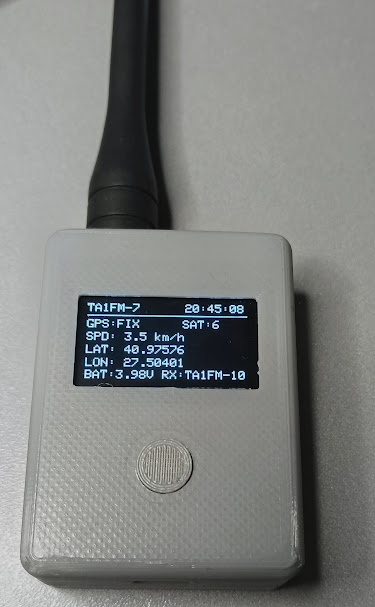
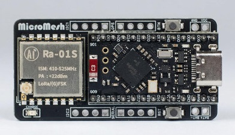

# TA1FM nrf52 Tracker + LoRa APRS Digipeater

**Current stable release / Güncel kararlı sürüm: V1.1.0 STABLE** · 19 November 2026 / 19 Kasım 2026

**[Download V1.1.0 STABLE / İndir](https://github.com/TA1FM/TA1FM-nrf52-Aprs-Tracker/releases/tag/v1.1.0)** · **[Web&BLE Control Panel / Web Ayar&BLE Paneli](https://ta1fm.github.io/TA1FM-nrf52-Aprs-Tracker-Configurator/TA1FM_Tracker_Control_Panel_V1_1_0_STABLE.html)**

nRF52840 MiniMesh-based **433.775 MHz LoRa APRS Tracker and Digipeater** with GPS, OLED, USB/Bluetooth configuration, APRS messaging, and wireless firmware updates.

nRF52840 MiniMesh tabanlı; GPS, OLED, USB/Bluetooth ayarları, APRS mesajlaşma ve kablosuz firmware güncellemesi destekleyen **433.775 MHz LoRa APRS Tracker ve Digipeater** projesi.

## 🇹🇷 Türkçe

### V1.1.0 STABLE özellikleri

- **Tracker:** GPS konum, SMART/FIXED beacon, park sembolü, geçerli GPS yön/hız bilgisi (`ccc/sss`).
- **Digipeater:** TRACKER/DIGI seçimi, WIDE tekrarı, sabit koordinattan beacon.
- **APRS mesajları:** LoRa üzerinden alma/gönderme, ACK ve yeniden denemeler; RAM'de son 10 mesaj.
- **Web paneli:** USB veya Bluetooth BLE üzerinden ayarlar, canlı durum ve mesajlaşma.
- **Güncelleme:** Web panelinden `AdaDFU` moduna geçiş ve Android Nordic DFU uygulamasıyla ZIP yükleme.
- **Ekran ve radyo:** SH1106/SSD1306 OLED; SX1262/SX1268 seçimi; isteğe bağlı BME280.
- **Kalıcı ayarlar:** Direct Flash A/B + CRC32; firmware sürüm numarası merkezi tanımlardan yönetilir.
- **Gönderim planlama:** Status önceliği ve Comment zamanlama iyileştirmeleri; ortak 10 saniye RF TX koruması.

**İndirilecek dosyalar (Release → Assets):** `.ino` kaynak kod, `.uf2` USB bootloader, `.zip` Bluetooth OTA DFU. **BLE güncellemede ZIP; USB UF2 yüklemede UF2 kullanılır.**

### Rehberler

- [Kurulum (TR)](./KURULUM_TR.md)
- [Kullanım (TR)](./KULLANIM_TR.md)
- [Seri konsol komutları (TR)](./SERI_KONSOL_KOMUT_REHBERI_TR.md)
- [Donanım pin bağlantıları (TR)](./PIN_BAGLANTILARI_TR.md)

### BLE OTA DFU — önemli ayarlar

1. [Web panelinden](https://ta1fm.github.io/TA1FM-nrf52-Aprs-Tracker-Configurator/TA1FM_Tracker_Control_Panel_V1_1_0_STABLE.html) `nRF52_Lora_Tracker` cihazına bağlanın, **Kaydetme Açık** konumuna getirin, **BLE DFU Moduna Geç** seçin.
2. Cihaz yeniden başlayarak **AdaDFU** ismiyle görünür.
3. Android **nRF Device Firmware Update** uygulamasında Release'teki **ZIP** dosyasını seçip **AdaDFU** cihazına bağlanın.
4. **PRN = 4**, **Request High MTU = OFF** ayarlarıyla yükleyin. Aktarım boyunca gücü kesmeyin.

Test edilen bootloader: **nice!nano UF2 0.10.0 / S140 6.1.1**. Legacy/single-bank DFU kesintisinde uygulama kaybolabilir; USB UF2 kurtarma gerekebilir. Yükleme süresi bağlantıya göre değişir. Detaylar: [Kurulum rehberi](./KURULUM_TR.md).

## 🇬🇧 English

### V1.1.0 STABLE features

- GPS-based SMART/FIXED APRS tracking, parked symbol and GPS course/speed (`ccc/sss`) in position packets.
- Selectable TRACKER / fixed-position DIGI mode with WIDE packet repeating.
- LoRa APRS message inbox/outbox, ACK and limited retries; last 10 received messages stored in RAM.
- USB and Bluetooth BLE web control panel, SH1106/SSD1306 OLED, SX1262/SX1268 radio selection; optional BME280.
- Direct Flash A/B + CRC32 configuration storage; centralized firmware version labels.
- Improved Status/Comment scheduling and shared RF transmission guard.
- **Wireless OTA:** enter `AdaDFU` from the panel; use Nordic's Android DFU app with the release ZIP.

**Release assets:** `.ino` source, `.uf2` for USB UF2, `.zip` for BLE DFU.

**Recommended tested DFU settings:** **PRN 4; Request High MTU OFF.** Use the compatible nice!nano 0.10.0 UF2 bootloader / S140 6.1.1. Legacy single-bank updates can require USB recovery after interruption.

### Documentation

- [Installation (EN)](./INSTALL_EN.md)
- [User guide (EN)](./USER_GUIDE_EN.md)
- [Serial console commands (EN)](./SERIAL_CONSOLE_COMMAND_GUIDE_EN.md)
- [Release V1.1.0](https://github.com/TA1FM/TA1FM-nrf52-Aprs-Tracker/releases/tag/v1.1.0)

## Hardware / Donanım

- **Target / Hedef:** compatible nRF52840 MiniMesh Lite NRF.
- **Radio / LoRa:** SX1262 or SX1268; **433.775 MHz**, SF12 / BW125 / CR 4/5.
- **Display / OLED:** SH1106 or SSD1306, 128×64.
- **GPS:** supported GPS wired to the firmware's UART pins.
- **Sensor:** optional BME280 for WX; missing sensor does not imply faulty GPS/LoRa.

**Safety / Güvenlik:** Connect a suitable antenna before any RF transmission. Use your own licensed amateur callsign; respect local regulations. A device-level ACK does **not** prove a human read a message. Saving settings over BLE without a PIN is not strong authentication.

## 📸 TA1FM Tracker Fotoğrafları / Photos

### Tamamlanmış Tracker / Finished Tracker

  

### Donanım / Hardware

| MicroMesh Lite NRF | Tracker İç Görünümü |
|:---:|:---:|
|  |  |

---

### MicroMesh Tracker — Diğer Görünümler

  
  

## 🛠️ nRF52840 Pro Micro — DIY bağlantı görseli

Kendi TA1FM nRF52 Tracker + Digipeater devresini kurmak isteyenler için **nRF52840 Pro Micro, SX1262/SX1268 LoRa, GPS, OLED ve isteğe bağlı BME280** bağlantılarını gösteren şema:

  

**[Büyük görsel ve ayrıntılı pin bağlantıları → PIN_BAGLANTILARI_TR.md](./PIN_BAGLANTILARI_TR.md)**

> **Montaj notu:** Görsel DIY bağlantı rehberidir; Pro Micro kart revizyonunu, LoRa modülünün RF anahtarı/TCXO ve güç bağlantılarını ayrıca doğrulayın. Firmware ile eşleşen güncel pin tablosu [pin rehberinde](./PIN_BAGLANTILARI_TR.md) yer alır.

### 🔩 fakeTec PCB V4 — TA1FM DIY donanım eşleşmesi

**[fakeTec PCB](https://github.com/gargomoma/fakeTec_pcb)** topluluğunun **[V4 (Issue #16)](https://github.com/gargomoma/fakeTec_pcb/issues/16)** tasarımındaki **nRF52840 Pro Micro GPIO pin eşlemesi**, TA1FM **V0.9.24 STABLE dönemindeki** kaynak kodun kullandığı LoRa, GPS, OLED/I²C, buton ve batarya ADC pinleriyle **örtüşüyor**. Bu nedenle fakeTec V4, kendi TA1FM Tracker/Digipeater cihazını yapmak isteyenler için **aday PCB**'dir.

- **[Orijinal fakeTec projesi](https://github.com/gargomoma/fakeTec_pcb)** · **[V4 tasarım / montaj açıklaması](https://github.com/gargomoma/fakeTec_pcb/issues/16)** · **[Gerber arşivi](https://github.com/gargomoma/fakeTec_pcb/tree/main/gerbers)** · **[V4 Gerber ZIP](https://github.com/gargomoma/fakeTec_pcb/blob/main/gerbers/lupusworax_fakeTec_pcb_v4_GERBER.zip)**
- **Kontrol edilen eşleşmeler:** LoRa SPI `P1.11/P1.15/P0.02`, CS `P1.13`, DIO1 `P0.10`, BUSY `P0.29`, RESET `P0.09`, RXEN `P0.17`; OLED/BME280 SDA `P1.04`, SCL `P0.11`; GPS UART `P0.20/P0.22`, GPS_EN `P0.24`; buton `P1.00`, batarya ADC `P0.31`.
- **[fakeTec V4 için ayrıntılı uyumluluk notları ve kontrol listesi](./PIN_BAGLANTILARI_TR.md#faketec-v4-pcb-uyumlulugu-ve-diy-kurulum)**

> **Doğrulama sınırı:** Eşleşme **firmware GPIO haritası ve fakeTec dokümanları** üzerindendir; **fakeTec V4 üzerinde V1.1.0 STABLE fiziksel uyumluluk testi yapılmadı**. Kart revizyonu, LoRa çipi/TCXO/RF anahtarı, bootloader/SoftDevice, GPS güç kontrolü ve **batarya bölücü kalibrasyonu** kontrol edilmeden doğrudan uyum/UF2 garantisi verilmez. Gerber'leri üretime göndermeden önce ilgili V4 issue'sundaki son revizyonu okuyun.

**Tasarım atfı:** [gargomoma/fakeTec_pcb](https://github.com/gargomoma/fakeTec_pcb) · fakeTec V4 katkısı: **lupusworax** (issue içinde **Severin**'in PCB çizimine katkısı da belirtilmiştir). **TA1FM projesi fakeTec PCB tasarımının sahibi değildir.**

## Previous versions / Önceki sürümler

Historical releases, firmware and notes remain available under **[Releases](https://github.com/TA1FM/TA1FM-nrf52-Aprs-Tracker/releases)** and Git history. Older release-specific documents (V0.9.x) are retained as archives, **not** as current installation instructions.

**73 de TA1FM 📡**
