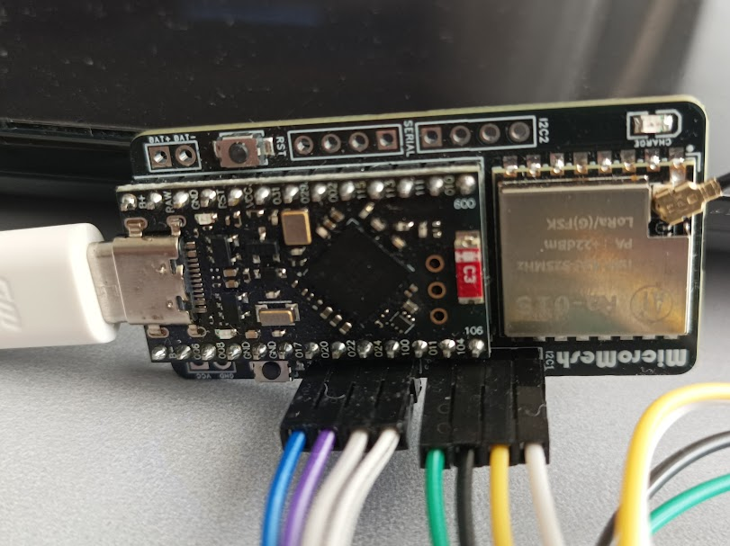

# TA1FM nrf52 Tracker + LoRa APRS Digipeater

## 📡 Güncel kararlı sürüm: v1.3.0 STABLE — 24 Kasım 2026

**[📦 v1.3.0 STABLE sürümünü indir](https://github.com/TA1FM/TA1FM-nrf52-Aprs-Tracker/releases/tag/v1.3.0)** · [Arduino kaynak (.ino)](./TA1FM_nrf52_Tracker_v1.3.0_STABLE.ino) · [Sürüm notları](./RELEASE_NOTES_V1_3_0_STABLE.md)

**Firmware dosyaları GitHub Releases → Assets bölümünde:** `TA1FM_nrf52_Tracker_v1.3.0_STABLE.ino`, `TA1FM_nrf52_Tracker_v1.3.0_STABLE.ino.uf2`, `TA1FM_nrf52_Tracker_v1.3.0_STABLE.ino.zip` (BLE DFU paketi). **ZIP dosyasını UF2 sürücüsüne kopyalamayın.**

### 🌐 Güncel uyumlu USB / BLE kontrol paneli

**[TA1FM v1.3.0 birleşik kontrol panelini aç](https://ta1fm.github.io/TA1FM-nrf52-Aprs-Tracker-Configurator/BETA/TA1FM_Tracker_Control_Panel_v1.3.0_BETA2.html)**

Panelin dosya adında **BETA2** bulunması, panelin geliştirme revizyonunu ifade eder; **v1.3.0 STABLE firmware ile uyumludur**. Firmware için ayrıca yeni bir panel sürümü zorunlu değildir.

## 🇹🇷 Özellikler / Features

- **TRACKER:** GPS/GNSS, SMART/FIXED beacon, hareket ve park sembolleri (OLED hızlı seçim: **Car / Motorcycle / Walker**), APRS Comment ve ayrı Status paketi.
- **Sabit DIGI:** WIDE1/WIDE2 yol tekrarları, sabit konum beacon'ı; **internet iGate değildir**.
- **Mesajlaşma:** USB/BLE APRS mesajları, ACK ve sınırlı tekrar, son **3 gelen mesaj RAM'de** (yeniden başlatmada silinir); OLED'de en çok **6 kalıcı hazır mesaj**.
- **Bildirim:** Cihaza adresli yeni mesajda isteğe bağlı aktif buzzer ve **15/30/60 saniye** OLED uyandırma.
- **Telemetri:** `telem on` ile Base91 pil voltajı; sağlıklı BME280 varsa sıcaklık/nem/basınç da eklenir. **Sensör yoksa pil telemetrisi devam eder, sahte hava verisi gönderilmez.** `telem defs` sensör durumuna uygun APRS tanımlarını gönderir.
- **OLED:** SH1106/SSD1306; **SYSTEM STATUS** ve fiziksel OLED menüsünden çift onaylı **DFU MODE**.
- **Donanım ve ayarlar:** nRF52840 MiniMesh pin düzeni, SX1262/SX1268 seçimi, 433.775 MHz LoRa APRS; Direct Flash A/B kalıcı ayarlar.
- **Güncelleme:** Uyumlu bootloader ile USB UF2 veya Android Nordic BLE DFU ZIP. Web paneli DFU modunu başlatır; **ZIP'i web tarayıcısından aktarmak yerine Nordic DFU uygulamasını kullanın**.

### 🇹🇷 Türkçe belgeler

[Kurulum](./KURULUM_TR.md) · [Kullanım](./KULLANIM_TR.md) · [Seri komutlar](./SERI_KONSOL_KOMUT_REHBERI_TR.md) · [Pinler](./PIN_BAGLANTILARI_TR.md) · [v1.3.0 sürüm notları](./RELEASE_NOTES_V1_3_0_STABLE.md)

### 🇬🇧 English documentation

[Installation](./INSTALL_EN.md) · [User guide](./USER_GUIDE_EN.md) · [Serial commands](./SERIAL_CONSOLE_COMMAND_GUIDE_EN.md)

**Hardware warning:** This is not a universal nRF52840 firmware. Verify PCB variant, SPI/GPIO mapping, RF switch, TCXO, bootloader/SoftDevice and antenna before installation. Use an authorized amateur callsign and comply with local RF regulations. APRS ACK confirms device receipt, not human reading.

## 📁 Önceki sürümler / Archive

Eski v1.2.0 STABLE ve v0.9.x dosyaları/rehberleri arşiv olarak korunmaktadır. **Güncel kurulum ve firmware için v1.3.0 Release dosyalarını kullanın.** GitHub tarafından sunulan kaynak arşivi ile BLE DFU ZIP aynı şey değildir.

## 📸 Fotoğraflar / Photos

### Tamamlanmış Tracker / Finished tracker

### Hardware / Donanım

| MiniMesh kartı | Cihazın içi |
|:---:|:---:|
|  |  |

### Pro Micro DIY wiring / Bağlantı şeması

The DIY diagram is a reference only; verify actual PCB revision, RF switch, TCXO, power design and GPIO. See [pin guide and fakeTec V4 compatibility caveats](./PIN_BAGLANTILARI_TR.md#faketec-v4-pcb-uyumlulugu-ve-diy-kurulum). Original PCB project: [gargomoma/fakeTec_pcb](https://github.com/gargomoma/fakeTec_pcb); TA1FM does not own the third-party design.

## Archived releases / Eski sürümler

Older V0.9.x, V1.0 and V1.1 documentation is kept in Git history and archived directories; use the current installation and user guides above for v1.3.0.

**73 de TA1FM 📡**
