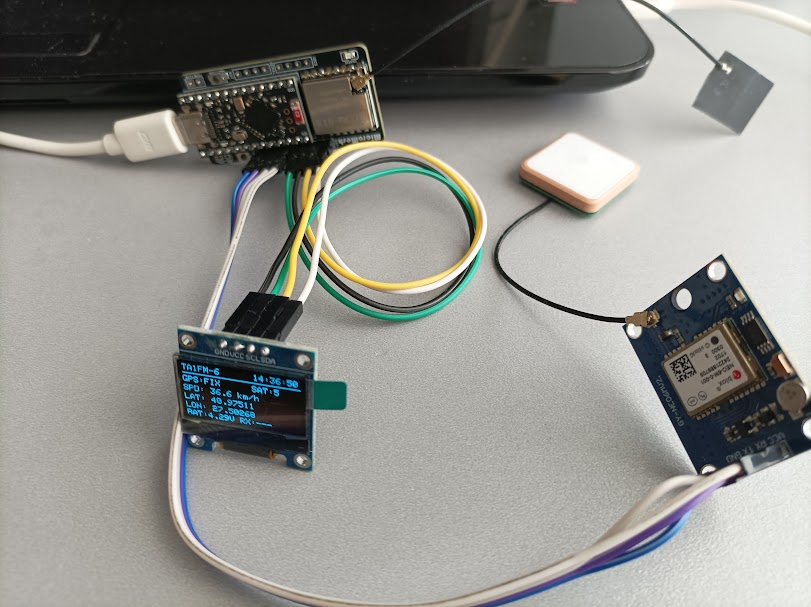
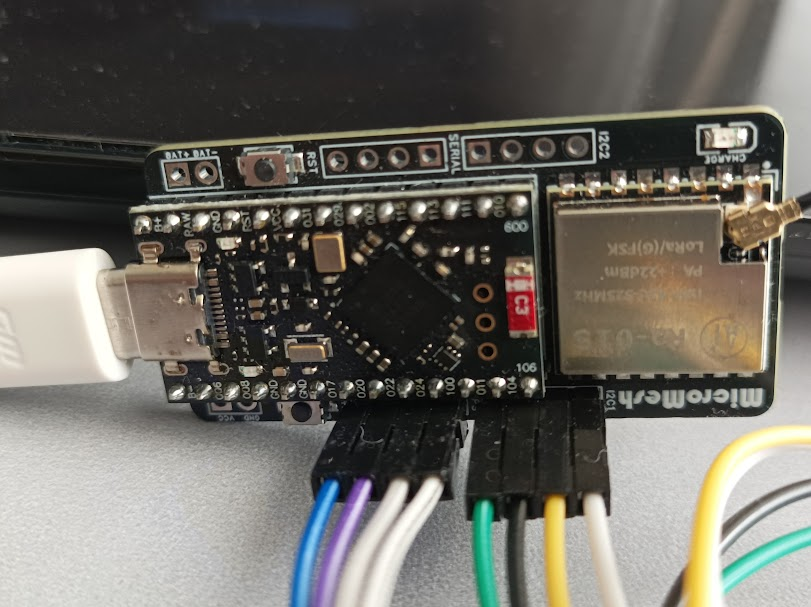

# TA1FM nRF52 LoRa APRS Tracker

**Current firmware / Güncel sürüm: V0.9.22 UNIVERSAL BLE** · **LoRa APRS: 433.775 MHz (SF12 / BW125 / CR 4/5)**

GPS/LoRa APRS tracker for **TA2DMX MiniMesh Lite NRF (nRF52840)** with SX1262 or SX1268, optional BME280, SH1106/SSD1306 OLED, USB and Bluetooth BLE configuration.

**TR:** V0.9.22 ile tek firmware üzerinden **SX1262 / SX1268 çip seçimi**, USB + BLE ayar yönetimi, ayrı **hareket/park harita sembolleri**, OLED sürücü kaydı, Smart Beacon ve **Direct Flash A/B + CRC32** ayar saklama desteği bulunur. Önceki V0.9.x dosyaları tarihsel sürümler olarak korunur.

## 📸 TA1FM Tracker Fotoğrafları / Photos

### Tamamlanmış Tracker / Finished Tracker

  

### Donanım / Hardware

| MicroMesh Lite NRF | Tracker İç Görünümü |
|:---:|:---:|
|  |  |

---

### MicroMesh Tracker — Diğer Görünümler

  
  

## 🌐 Web Configurator / Ayar paneli

**[TA1FM USB + BLE Web Configurator — Open / Aç](https://ta1fm.github.io/TA1FM-nrf52-Aprs-Tracker-Configurator/)**

| Connection / Bağlantı | How to use / Kullanım |
|---|---|
| **USB** | Desktop Chrome/Edge, USB data cable; **Cihaza bağlan → Cihazdan oku (p) → Ayarları cihaza yaz**. Serial monitor cannot use the same COM port simultaneously. |
| **BLE** | Android Chrome over **HTTPS**, Bluetooth enabled; connect to **nRF52_Lora_Tracker**, tap **BLE Ayarları Oku**, enable **Kaydetme AÇIK**, then **BLE Ayarları Kaydet**. |
| **Backup / Yedek** | Export/import settings as **JSON**. Import fills the form; it does **not** write to the device until you explicitly save. |

**BLE save switch:** No PIN in V0.9.22. The switch only gates writes; it **is not a security/authentication feature**. It automatically returns to OFF after a successful save or BLE disconnect. Configuration is staged in RAM and committed in **one Direct Flash A/B transaction**. Flash initialization is intentionally USB-only.

## 📦 V0.9.22 firmware / İndir

| Artifact / Dosya | Link |
|---|---|
| **nRF52840 UF2 — flash-ready firmware** | [TA1FM_nrf52_Tracker_UNIVERSAL_BLE_V0_9_22.uf2](./TA1FM_nrf52_Tracker_UNIVERSAL_BLE_V0_9_22.uf2) |
| **Complete Arduino source** | [TA1FM_nrf52_Tracker_UNIVERSAL_BLE_V0_9_22.ino](./TA1FM_nrf52_Tracker_UNIVERSAL_BLE_V0_9_22.ino) |
| **Türkçe kullanım kılavuzu** | [KULLANIM_TR.md](./KULLANIM_TR.md) |
| **Türkçe kurulum** | [KURULUM_TR.md](./KURULUM_TR.md) |
| **English user guide** | [USER_GUIDE_EN.md](./USER_GUIDE_EN.md) |
| **English installation** | [INSTALL_EN.md](./INSTALL_EN.md) |
| **Pin connections / Bağlantı tablosu** | [PIN_BAGLANTILARI_TR.md](./PIN_BAGLANTILARI_TR.md) |
| **Version changes / Sürüm notları** | [CHANGELOG_V0_9_22.md](./CHANGELOG_V0_9_22.md) |

**Keep a backup of your known-good UF2 and current settings before changing firmware or LoRa chip. / Çalışan UF2 ve ayar yedeğini saklayın.**

## ✨ V0.9.22 features / Özellikler

- **Universal SX1262 / SX1268 selection:** choose the actual installed LoRa chip via BLE web panel. **Reboot required** to activate a changed chip; RF stays disabled until restart when the chip setting changes. Incorrect chip selection can stop RF operation.
- **BLE device name:** `nRF52_Lora_Tracker`; Nordic UART Service (NUS), live GPS/satellite/radio/battery readout, settings read/write, no PIN.
- **APRS symbols / Harita sembolleri:** separately enter **moving** (e.g. `/>`) and **parked** (e.g. `\P`) symbol codes. The first character is the APRS table (`/` or `\`), the second is the symbol; choose valid APRS symbols.
- **OLED:** SH1106/SSD1306 and sleep settings. **BLE** changes the driver immediately after confirmed flash save, without a preview countdown. **USB** keeps preview/confirm. If display remains blank, the **3-second button hold at power-on** remains available for recovery.
- **Position beacons:** SMART or FIXED, parked recognition, first-motion trigger, configurable intervals.
- **Startup APRS:** when AUTO/Status/Comment are enabled and a valid GPS fix is available, first position packet includes Comment; separate Status follows subject to **15-second common LoRa TX guard**. Comment is **not a separate RF packet**.
- **WX:** independent BME280-based APRS weather transmission (optional sensor); position beacon may append battery voltage as comment text.
- **Persistence:** verified **Direct Flash A/B + CRC32** records, not LittleFS; BLE saves changed settings in one transaction. **APRS messaging is not implemented.**

### Smart Beacon default intervals

| GPS speed | Time |
|---|---:|
| 0–7 km/h | 600 s |
| 10 km/h | 90 s |
| 20 km/h | 45 s |
| 49 km/h | 30 s |
| 60 km/h | 20 s |
| 90+ km/h | 15 s |

Time is interpolated between the speed breakpoints; all six values are configurable. **Every LoRa RF transmission is subject to a minimum 15-second guard**, not a promise of airtime or reception.

## 🔧 Installation / Kurulum

1. Verify the **MiniMesh Lite NRF** hardware, UF2 bootloader, and whether the radio chip is **SX1262 or SX1268**.
2. Back up your current configuration and known-working UF2.
3. **Double-tap RESET** to mount the UF2 drive, then copy [V0.9.22 UF2](./TA1FM_nrf52_Tracker_UNIVERSAL_BLE_V0_9_22.uf2).
4. Open the [web configurator](https://ta1fm.github.io/TA1FM-nrf52-Aprs-Tracker-Configurator/) and read the actual settings before writing. For BLE, enable the **Kaydetme** switch.
5. Check **Direct Flash ACTIVE**, callsign, chip selection, OLED type, symbols, AUTO and GPS FIX. If the chip is changed, restart the device.
6. Attach an antenna before RF TX; verify reception with an APRS iGate.

**Do not erase or format flash for routine updates.** On a device with no valid Direct Flash record, initialization is a separate advanced **USB-only** operation (`flash?` / `flash init`); see the installation guide and back up settings first.

## 📡 Module compatibility / Modül uyumu

| Radio chip | V0.9.22 support |
|---|---|
| **SX1262** | Select SX1262 in firmware settings; match the actual installed module and RF circuit |
| **SX1268 (Ra-01S)** | Select SX1268; old V0.9.14 Direct Flash records default to SX1268 if no explicit chip ID was saved |
| **LLCC68 (Ra-01SC)** | Not supported for this project's **433.775 MHz / SF12 / BW125** LoRa APRS configuration |

For historical firmware: [SX1262 V0.9.6](./TA1FM_nrf52_Tracker_V0_9_6_OLED_WEB.uf2) · [SX1268 V0.9.14](./TA1FM_nrf52_Tracker_V0_9_14_SX1268_OLED_WEB_DIRECT_FLASH.uf2). Earlier releases required separate builds; **V0.9.22 is universal within the listed supported hardware configuration**.

## ⚠️ Hardware compatibility / Donanım uyumu

**Hardware-specific firmware: do not install on arbitrary nRF52840 boards.**

- TA2DMX MiniMesh Lite NRF; custom TA1FM nRF52840 board definition.
- On the originally tested board: nice!nano / nRF52840 UF2 (`nRF52840-nicenano`), SoftDevice S140 6.1.1.
- SX1262: 433.775 MHz, SF12, BW125, CR 4/5; TCXO 1.8 V.
- L76K GPS; optional BME280; SH1106 or SSD1306 OLED.
- Arduino: custom Adafruit nRF52 core 1.7.0 board definition, RadioLib 7.8.1 and other libraries in source.

## 📜 Legal / Yasal uyarı

Use only authorized amateur-radio frequencies, callsigns and power limits for your jurisdiction. Software power setting is not a guarantee of measured RF output.

## 📄 License / Lisans

No open-source license has been granted by this repository yet. Publishing the source does not itself grant reuse, modification or redistribution rights; add a `LICENSE` file if you choose to license it.

**Project: TA1FM · Firmware: V0.9.22 UNIVERSAL BLE**

