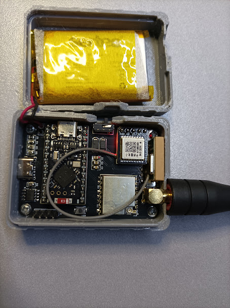
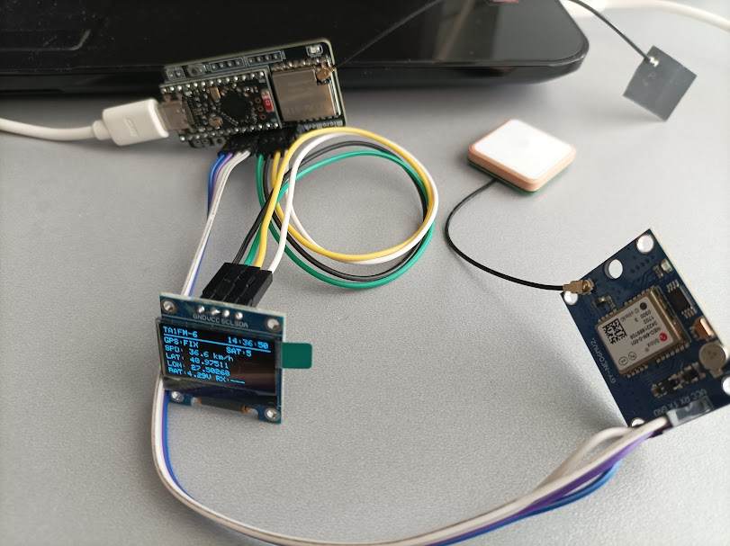

# TA1FM nRF52 LoRa APRS Tracker + Digipeater

## ✅ Güncel kararlı sürüm / Latest stable: v1.0.0

**17 Kasım 2026** · **nRF52840 MiniMesh Lite NRF** · **LoRa APRS 433.775 MHz (SF12 / BW125 / CR 4/5)**

**[🚀 v1.0.0 STABLE — GitHub Release](https://github.com/TA1FM/TA1FM-nrf52-Aprs-Tracker/releases/tag/v1.0.0)** · [UF2 firmware indir](https://github.com/TA1FM/TA1FM-nrf52-Aprs-Tracker/releases/download/v1.0.0/TA1FM_nrf52_Tracker_v1.0.0_STABLE.uf2) · [Arduino .ino kaynak kodunu indir](https://github.com/TA1FM/TA1FM-nrf52-Aprs-Tracker/releases/download/v1.0.0/TA1FM_nrf52_Tracker_v1.0.0_STABLE.ino)

**[🌐 TA1FM Tracker Control Panel — USB + BLE](https://ta1fm.github.io/TA1FM-nrf52-Aprs-Tracker-Configurator/)** · [Panel kaynak dosyası](https://github.com/TA1FM/TA1FM-nrf52-Aprs-Tracker-Configurator/blob/main/TA1FM_Tracker_Control_Panel.html)

Bu sürüm, **V0.9.26 BETA-7** temel alınarak yayımlandı. İki ayrı nRF52840 MiniMesh cihazında yapılan kullanıcı testlerinde başarılı sonuç alındı. Yüklenebilir .uf2 ve .ino dosyaları Release sayfasının **Assets** bölümündedir; önceki kararlı sürümler ve BETA kaynakları korunmuştur.

### Başlıca özellikler / Key features

- **TRACKER:** GPS konum yayını, SMART/FIXED beaconing, park modu ve APRS sembolleri.
- **DIGIPEATER:** Seçilebilir DIGI modu ve WIDE yol paket tekrarı.
- **APRS mesajlaşma:** LoRa üzerinden gönderim/alım, gelen kutusu, ACK takibi ve **1/2/3 toplam RF denemesi** seçimi. ACK, alıcı kişinin mesajı okuduğu anlamına gelmez.
- **USB + BLE kontrol:** Sekmeli panelde Mesajlar, Canlı, Ayarlar ve Kayıtlar; bağlantı seçimi ve cihaz durumunu izleme.
- **Donanım:** SX1262/SX1268 seçimi, SH1106/SSD1306 OLED, isteğe bağlı BME280, pil ve RF bilgileri.
- **Ayarlar:** Direct Flash A/B + CRC32 kalıcı ayar kaydı. **Gelen APRS mesajları RAM'de tutulur; cihaz kapatılınca silinir.**

### Kurulum / Quick start

1. Mevcut ayarlarınızı ve çalışan firmware yedeğinizi saklayın.
2. Kartınızın nRF52840 MiniMesh Lite NRF ve RF donanımının uygun olduğundan emin olun. RF gönderimi için anten bağlayın.
3. [v1.0.0 UF2 dosyasını](https://github.com/TA1FM/TA1FM-nrf52-Aprs-Tracker/releases/download/v1.0.0/TA1FM_nrf52_Tracker_v1.0.0_STABLE.uf2) Release bölümünden indirip **kartınızın desteklediği UF2 yükleme yöntemiyle** kurun.
4. [Güncel USB/BLE panelini](https://ta1fm.github.io/TA1FM-nrf52-Aprs-Tracker-Configurator/) açın. Önce cihazdan ayarları okuyun; ardından çağrı işareti, LoRa çipi, GPS, OLED ve mesaj ayarlarını kontrol edin.
5. USB bağlantısı sırasında aynı COM portunu kullanan seri monitörü kapatın. BLE için uyumlu tarayıcı ve HTTPS kullanın.

**Sürüm geçmişi:** [v0.9.24 STABLE](https://github.com/TA1FM/TA1FM-nrf52-Aprs-Tracker/releases/tag/v0.9.24) · [v0.9.22](https://github.com/TA1FM/TA1FM-nrf52-Aprs-Tracker/releases/tag/v0.9.22) · [BETA-7 kaynak arşivi](./BETA/TA1FM_nrf52_Tracker_UNIVERSAL_BLE_V0_9_26_BETA7_USB_BLE_TABS/)

> **Geliştirme planı:** İsteğe bağlı aktif buzzer ile APRS mesaj uyarısı sonraki sürümler için düşünülmektedir; **v1.0.0'da bulunmaz**.

---

## 📚 Önceki sürüm teknik notları — v0.9.24 arşivi

Aşağıdaki teknik bölümler **v0.9.24 dönemine ait** tarihsel dokümantasyondur. Burada görülen eski sürüm numaraları, indirme bağlantıları, panel adresleri ve “mesajlaşma yok” ifadeleri **v1.0.0 için geçerli değildir**. Güncel indirme ve kullanım bağlantıları yukarıdadır.

## 📡 Yeni özellik: LoRa APRS DIGIPEATER (DIGI) — V0.9.24

**Bu yazılım artık hem APRS Tracker hem de sabit Digipeater olarak kullanılabilir!** Uygun APRS paketlerini 433.775 MHz'de RF üzerinden tekrarlar; internet bağlantısı veya APRS-IS iGate özelliği gerektirmez.

| Çalışma modu | Görev |
|---|---|
| **TRACKER** | GPS + SMART/FIXED Beaconing ile hareketli APRS konum yayını |
| **DIGIPEATER / DIGI** | Sabit istasyon olarak uygun WIDE paketlerini RF'de tekrarlar ve kayıtlı koordinatlarından kendi beacon'ını gönderir |

**DIGI özellikleri:** Seçilebilir **WIDE1-1** veya **WIDE1-1 / WIDE2-1 / WIDE2-2** desteği · **30 saniyelik mükerrer paket filtresi** · **4 paketlik kuyruk** · **10 saniye RF TX koruması** · **10 / 15 / 30 / 60 dk sabit beacon aralığı** · başarılı/hatalı TX sayaçları · RX toparlanma kontrolü.

**DIGI kurulumu:** [V0.9.24 USB + BLE Web Ayar Paneli](https://ta1fm.github.io/TA1FM-nrf52-Aprs-Tracker-Configurator/beta_v0_9_23.html) üzerinden **DIGI** modunu seçin, istasyon çağrı işaretini ve sabit koordinatları girin. USB komutlarıyla `digi lat`, `digi lon`, `digi path 1|2`, `digi beacon 10|15|30|60`, `mode digi` de kullanılabilir.

**[DIGIPEATER kullanım ve ayar rehberi (Türkçe)](./DIGIPEATER_V0_9_24_TR.md)** · **[v0.9.24 STABLE GitHub Release](https://github.com/TA1FM/TA1FM-nrf52-Aprs-Tracker/releases/tag/v0.9.24)**

> **Test notu:** SX1268 ile TRACKER modu saha testinden geçmiştir. Yeni DIGI filtresi/toparlanması ve SX1262 performansı ayrıca saha testine ihtiyaç duyar. Bu cihaz internete APRS-IS paketi aktaran bir iGate değildir; RF Digipeater'dır.

## 📸 TA1FM Tracker Fotoğrafları / Photos

### Tamamlanmış Tracker / Finished Tracker

  

### Donanım / Hardware

| MicroMesh Lite NRF | Tracker İç Görünümü |
|:---:|:---:|
|  |  |

---

### MicroMesh Tracker — Diğer Görünümler

  
  

## 🛠️ nRF52840 Pro Micro — DIY bağlantı görseli

Kendi TA1FM nRF52 Tracker + Digipeater devresini kurmak isteyenler için **nRF52840 Pro Micro, SX1262/SX1268 LoRa, GPS, OLED ve isteğe bağlı BME280** bağlantılarını gösteren şema:

  

**[Büyük görsel ve ayrıntılı pin bağlantıları → PIN_BAGLANTILARI_TR.md](./PIN_BAGLANTILARI_TR.md)**

> **Montaj notu:** Görsel DIY bağlantı rehberidir; Pro Micro kart revizyonunu, LoRa modülünün RF anahtarı/TCXO ve güç bağlantılarını ayrıca doğrulayın. Firmware ile eşleşen güncel pin tablosu [pin rehberinde](./PIN_BAGLANTILARI_TR.md) yer alır.

### 🔩 fakeTec PCB V4 — TA1FM DIY donanım eşleşmesi

**[fakeTec PCB](https://github.com/gargomoma/fakeTec_pcb)** topluluğunun **[V4 (Issue #16)](https://github.com/gargomoma/fakeTec_pcb/issues/16)** tasarımındaki **nRF52840 Pro Micro GPIO pin eşlemesi**, TA1FM **V0.9.24 STABLE** kaynak kodunun kullandığı LoRa, GPS, OLED/I²C, buton ve batarya ADC pinleriyle **örtüşüyor**. Bu nedenle fakeTec V4, kendi TA1FM Tracker/Digipeater cihazını yapmak isteyenler için **aday PCB**'dir.

- **[Orijinal fakeTec projesi](https://github.com/gargomoma/fakeTec_pcb)** · **[V4 tasarım / montaj açıklaması](https://github.com/gargomoma/fakeTec_pcb/issues/16)** · **[Gerber arşivi](https://github.com/gargomoma/fakeTec_pcb/tree/main/gerbers)** · **[V4 Gerber ZIP](https://github.com/gargomoma/fakeTec_pcb/blob/main/gerbers/lupusworax_fakeTec_pcb_v4_GERBER.zip)**
- **Kontrol edilen eşleşmeler:** LoRa SPI `P1.11/P1.15/P0.02`, CS `P1.13`, DIO1 `P0.10`, BUSY `P0.29`, RESET `P0.09`, RXEN `P0.17`; OLED/BME280 SDA `P1.04`, SCL `P0.11`; GPS UART `P0.20/P0.22`, GPS_EN `P0.24`; buton `P1.00`, batarya ADC `P0.31`.
- **[fakeTec V4 için ayrıntılı uyumluluk notları ve kontrol listesi](./PIN_BAGLANTILARI_TR.md#faketec-v4-pcb-uyumlulugu-ve-diy-kurulum)**

> **Doğrulama sınırı:** Eşleşme **firmware GPIO haritası ve fakeTec dokümanları** üzerindendir; **TA1FM V0.9.24'ün fakeTec V4 üzerinde çalıştığı henüz fiziksel olarak test edilmedi**. Kart revizyonu, LoRa çipi/TCXO/RF anahtarı, bootloader/SoftDevice, GPS güç kontrolü ve **batarya bölücü kalibrasyonu** kontrol edilmeden doğrudan uyum/UF2 garantisi verilmez. Gerber'leri üretime göndermeden önce ilgili V4 issue'sundaki son revizyonu okuyun.

**Tasarım atfı:** [gargomoma/fakeTec_pcb](https://github.com/gargomoma/fakeTec_pcb) · fakeTec V4 katkısı: **lupusworax** (issue içinde **Severin**'in PCB çizimine katkısı da belirtilmiştir). **TA1FM projesi fakeTec PCB tasarımının sahibi değildir.**

## 🌐 Web Configurator / Ayar paneli

**[V0.9.24 uyumlu USB + BLE Web Configurator — Open / Aç](https://ta1fm.github.io/TA1FM-nrf52-Aprs-Tracker-Configurator/beta_v0_9_23.html)**

Eski V0.9.22 paneli: [Genel panel](https://ta1fm.github.io/TA1FM-nrf52-Aprs-Tracker-Configurator/)

| Connection / Bağlantı | How to use / Kullanım |
|---|---|
| **USB** | Desktop Chrome/Edge, USB data cable; **Cihaza bağlan → Cihazdan oku (p) → Ayarları cihaza yaz**. Serial monitor cannot use the same COM port simultaneously. |
| **BLE** | Android Chrome over **HTTPS**, Bluetooth enabled; connect to **nRF52_Lora_Tracker**, tap **BLE Ayarları Oku**, enable **Kaydetme AÇIK**, then **BLE Ayarları Kaydet**. |
| **Backup / Yedek** | Export/import settings as **JSON**. Import fills the form; it does **not** write to the device until you explicitly save. |

**BLE save switch:** No PIN in V0.9.24. The switch only gates writes; it **is not a security/authentication feature**. It automatically returns to OFF after a successful save or BLE disconnect. Configuration is staged in RAM and committed in **one Direct Flash A/B transaction**. Flash initialization is intentionally USB-only.

## 📦 V0.9.24 STABLE firmware / İndir

| Artifact / Dosya | Link |
|---|---|
| **nRF52840 UF2 — flash-ready firmware** | [TA1FM_nrf52_Tracker_UNIVERSAL_BLE_V0_9_24_STABLE.uf2](./TA1FM_nrf52_Tracker_UNIVERSAL_BLE_V0_9_24_STABLE.uf2) |
| **Complete Arduino source** | [TA1FM_nrf52_Tracker_UNIVERSAL_BLE_V0_9_24_STABLE.ino](./TA1FM_nrf52_Tracker_UNIVERSAL_BLE_V0_9_24_STABLE.ino) |
| **Türkçe kullanım kılavuzu** | [KULLANIM_TR.md](./KULLANIM_TR.md) |
| **Türkçe kurulum** | [KURULUM_TR.md](./KURULUM_TR.md) |
| **English user guide** | [USER_GUIDE_EN.md](./USER_GUIDE_EN.md) |
| **English installation** | [INSTALL_EN.md](./INSTALL_EN.md) |
| **Pin connections / Bağlantı tablosu** | [PIN_BAGLANTILARI_TR.md](./PIN_BAGLANTILARI_TR.md) |
| **Version changes / Sürüm notları** | [V0_9_24_STABLE_NOTLARI.md](./V0_9_24_STABLE_NOTLARI.md) |
| **DIGIPEATER ayar / kullanım rehberi** | [DIGIPEATER_V0_9_24_TR.md](./DIGIPEATER_V0_9_24_TR.md) |
| **USB seri konsol komutları (V0.9.24 TR)** | [SERI_KONSOL_KOMUT_REHBERI_V0_9_24_TR.md](./SERI_KONSOL_KOMUT_REHBERI_V0_9_24_TR.md) |
| **GitHub Release v0.9.24** | [Release / Assets](https://github.com/TA1FM/TA1FM-nrf52-Aprs-Tracker/releases/tag/v0.9.24) |

**Bu STABLE dosyaları, test edilmiş BETA kaynak ve UF2 ile byte-for-byte aynıdır; yeniden derlenmemiştir. Bu nedenle bazı açılış/debug metinleri BETA veya V23 şeklinde kalabilir.**

**Not:** V0.9.22 eski kararlı sürüm olarak korunmaktadır: [UF2](./TA1FM_nrf52_Tracker_UNIVERSAL_BLE_V0_9_22.uf2) · [INO](./TA1FM_nrf52_Tracker_UNIVERSAL_BLE_V0_9_22.ino). [v0.9.24 STABLE Release yayımlandı](https://github.com/TA1FM/TA1FM-nrf52-Aprs-Tracker/releases/tag/v0.9.24).

**Keep a backup of your known-good UF2 and current settings before changing firmware or LoRa chip. / Çalışan UF2 ve ayar yedeğini saklayın.**

## ✨ V0.9.24 features / Özellikler

- **New DIGIPEATER / DIGI mode:** selectable from USB/BLE panel or USB serial commands; repeats WIDE1-1 and optionally WIDE2-1/WIDE2-2 packets, 30-second duplicate suppression, four-packet queue, fixed own-position beacon every 10/15/30/60 minutes. TRACKER and DIGI are separate modes.
- **Universal SX1262 / SX1268 selection:** choose the actual installed LoRa chip via BLE web panel. **Reboot required** to activate a changed chip; RF stays disabled until restart when the chip setting changes. Incorrect chip selection can stop RF operation.
- **BLE device name:** `nRF52_Lora_Tracker`; Nordic UART Service (NUS), live GPS/satellite/radio/battery readout, settings read/write, no PIN.
- **APRS symbols / Harita sembolleri:** separately enter **moving** (e.g. `/>`) and **parked** (e.g. `\P`) symbol codes. The first character is the APRS table (`/` or `\`), the second is the symbol; choose valid APRS symbols.
- **OLED:** SH1106/SSD1306 and sleep settings. **BLE** changes the driver immediately after confirmed flash save, without a preview countdown. **USB** keeps preview/confirm. If display remains blank, the **3-second button hold at power-on** remains available for recovery.
- **Position beacons:** SMART or FIXED, parked recognition, first-motion trigger, configurable intervals.
- **Startup APRS:** when AUTO/Status/Comment are enabled and a valid GPS fix is available, first position packet includes Comment; separate Status follows subject to **10-second common LoRa TX guard**. Comment is **not a separate RF packet**.
- **WX:** independent BME280-based APRS weather transmission (optional sensor); position beacon may append battery voltage as comment text.
- **Persistence:** verified **Direct Flash A/B + CRC32** records, not LittleFS; BLE saves changed settings in one transaction. **APRS messaging is not implemented.**
- **V0.9.24 improvements:** SX1262/SX1268 140 mA RF OCP support; 30-second DIGI duplicate filter (previously 120 seconds), DIGI RX recovery and more accurate TX logging, reduced repetitive GPS/BME serial messages.

### Smart Beacon default intervals

| GPS speed | Time |
|---|---:|
| 0–7 km/h | 600 s |
| 10 km/h | 90 s |
| 20 km/h | 45 s |
| 49 km/h | 30 s |
| 60 km/h | 20 s |
| 90+ km/h | 15 s |

Time is interpolated between the speed breakpoints; all six values are configurable. **Every LoRa RF transmission is subject to a minimum 10-second guard**, not a promise of airtime or reception.

## 🔧 Installation / Kurulum

1. Verify the **MiniMesh Lite NRF** hardware, UF2 bootloader, and whether the radio chip is **SX1262 or SX1268**.
2. Back up your current configuration and known-working UF2.
3. **Double-tap RESET** to mount the UF2 drive, then copy [V0.9.24 STABLE UF2](./TA1FM_nrf52_Tracker_UNIVERSAL_BLE_V0_9_24_STABLE.uf2).
4. Open the [V0.9.24-compatible web configurator](https://ta1fm.github.io/TA1FM-nrf52-Aprs-Tracker-Configurator/beta_v0_9_23.html) and read the actual settings before writing. For BLE, enable the **Kaydetme** switch.
5. Check **Direct Flash ACTIVE**, callsign, chip selection, OLED type, symbols, AUTO and GPS FIX. If the chip is changed, restart the device.
6. Attach an antenna before RF TX; verify reception with an APRS iGate.

**Do not erase or format flash for routine updates.** On a device with no valid Direct Flash record, initialization is a separate advanced **USB-only** operation (`flash?` / `flash init`); see the installation guide and back up settings first.

## 📡 Module compatibility / Modül uyumu

| Radio chip | V0.9.24 support |
|---|---|
| **SX1262** | Select SX1262 in firmware settings; match the actual installed module and RF circuit |
| **SX1268 (Ra-01S)** | Select SX1268; old V0.9.14 Direct Flash records default to SX1268 if no explicit chip ID was saved |
| **LLCC68 (Ra-01SC)** | Not supported for this project's **433.775 MHz / SF12 / BW125** LoRa APRS configuration |

For historical firmware: [SX1262 V0.9.6](./TA1FM_nrf52_Tracker_V0_9_6_OLED_WEB.uf2) · [SX1268 V0.9.14](./TA1FM_nrf52_Tracker_V0_9_14_SX1268_OLED_WEB_DIRECT_FLASH.uf2). Earlier releases required separate builds; **V0.9.24 is universal within the listed supported hardware configuration (SX1268 TRACKER field tested; SX1262 and updated DIGI mode require separate verification)**.

## ⚠️ Hardware compatibility / Donanım uyumu

**Hardware-specific firmware: do not install on arbitrary nRF52840 boards.**

- TA2DMX MiniMesh Lite NRF; custom TA1FM nRF52840 board definition.
- On the originally tested board: nice!nano / nRF52840 UF2 (`nRF52840-nicenano`), SoftDevice S140 6.1.1.
- SX1262: 433.775 MHz, SF12, BW125, CR 4/5; TCXO 1.8 V.
- L76K GPS; optional BME280; SH1106 or SSD1306 OLED.
- Arduino: custom Adafruit nRF52 core 1.7.0 board definition, RadioLib 7.8.1 and other libraries in source.

## 📜 Legal / Yasal uyarı

Use only authorized amateur-radio frequencies, callsigns and power limits for your jurisdiction. Software power setting is not a guarantee of measured RF output.

## 📄 License / Lisans

No open-source license has been granted by this repository yet. Publishing the source does not itself grant reuse, modification or redistribution rights; add a `LICENSE` file if you choose to license it.

**Project: TA1FM · Firmware: V0.9.24 STABLE · TRACKER + DIGIPEATER · UNIVERSAL BLE**

