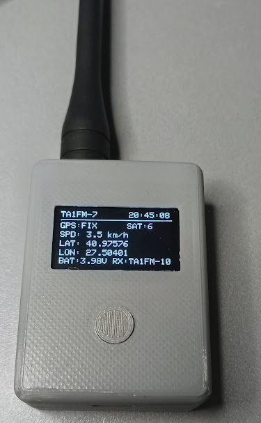
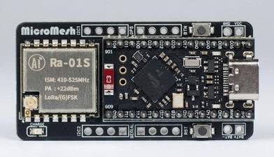
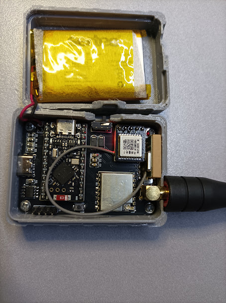

# TA1FM nRF52 LoRa APRS Tracker

## 📸 TA1FM Tracker Fotoğrafları / Photos

### Tamamlanmış Tracker / Finished Tracker

  

### Donanım / Hardware

| MicroMesh Lite NRF | Tracker İç Görünümü |
|:---:|:---:|
|  |  |

---

**Current firmware / Güncel sürüm: V0.9.5 STABLE** · **TA2DMX MiniMesh Lite NRF (nRF52840 / SX1262)** · **433.775 MHz LoRa APRS**

> **TR:** TA1FM nRF52 Tracker; GPS, LoRa APRS konum/WX gönderimi, hız duyarlı Smart Beacon, ayarlanabilir çıkış gücü ve OLED güç tasarrufu sunar. V0.9.5 saha testinde başarılı olmuştur.
>
> **EN:** GPS/LoRa APRS position and weather tracker with speed-adaptive Smart Beacon, adjustable TX power and OLED timeout. V0.9.5 has been successfully field-tested by the project owner.

## 🌐 Web Configurator / Web Ayar Paneli

**[TA1FM Web Configurator — Aç / Open](https://ta1fm.github.io/TA1FM-nrf52-Aprs-Tracker-Configurator/)**

**TR:** Masaüstü Chrome veya Edge ile USB üzerinden bağlanarak ayarları okuyabilir, değiştirebilir, kaydedebilir, JSON yedeği alabilir ve seri konsolu görebilirsiniz.

**EN:** Use desktop Chrome or Edge to connect via USB. Read/write settings, make JSON backups and use the serial monitor.

## 📦 Firmware ve kaynak kod / Firmware and source

| Dosya / File | Açıklama / Description |
| --- | --- |
| [V0.9.5 firmware UF2](./TA1FM_nrf52_Tracker_V0_9_5_SMART_BATT.uf2) | nRF52840 UF2 firmware / Yüklemeye hazır |
| [V0.9.5 Arduino INO](./TA1FM_nrf52_Tracker_V0_9_5_SMART_BATT.ino) | Complete Arduino source / Tam kaynak kod |
| [KURULUM_TR.md](./KURULUM_TR.md) | Türkçe kurulum (bazı bölümler önceki sürüme ait olabilir) |
| [INSTALL_EN.md](./INSTALL_EN.md) | English install guide (some sections may describe older releases) |

Keep previous working firmware and config backups. / Önceki çalışan firmware'i ve ayar yedeğini saklayın.

## 🚗 V0.9.5: Smart Beacon ayarları / Speed-based beaconing

| GPS speed / GPS hızı | Default interval / Varsayılan aralık |
| --- | --- |
| 0–7 km/h | 600 s (10 min) |
| 10 km/h | 90 s |
| 20 km/h | 45 s |
| 49 km/h | 30 s |
| 60 km/h | 20 s |
| 90 km/h or faster | 15 s |

- **TR:** İki hız noktası arasında süre kademeli hesaplanır. Altı aralık web arayüzünden değiştirilebilir; LittleFS hafızasına kaydedilir.
- **EN:** Timing is interpolated between breakpoints. All six intervals are editable via Web Configurator and saved to LittleFS.
- **İlk hareket / First motion:** Smart mode can request a position beacon when movement is confirmed; switchable ON/OFF. Actual sending still needs valid GPS and RF transmission guard.
- **Viraj / Corner:** Direction changes can trigger additional beacons while moving.
- **Note:** Beacon scheduling intervals do not guarantee the receiving iGate will hear every transmission.

## 🔋 Pil voltajı / Battery voltage beacon

- Optional battery voltage in the **position packet comment**, e.g. `Batt=3.92V`.
- Web Configurator: ON/OFF (default ON), saved to LittleFS.
- Invalid/unavailable voltage measurements are not included.
- This is packet comment text, **not structured APRS telemetry**; it does not require a separate battery RF transmission.

## 📡 TX POWER / Çıkış gücü

- 1–22 dBm **requested SX1262 power** adjustable via Web Configurator or `TX POWER` OLED menu.
- LittleFS storage retains the selected value after restart.
- RF power actually measured at the antenna connector depends on the board RF stage; observe legal and hardware limits.

## 🖥️ OLED Timer / Ekran zamanlayıcı

- Always ON / Always OFF / 15 s / 30 s / 1 min / 2 min / 5 min.
- Wakes on button press in timed modes; settings persist in LittleFS.
- OLED timeout does **not** stop GPS, LoRa RX/TX or APRS scheduling.
- SH1106 and SSD1306 display selection supported.
- Short OLED firmware version string: **V0.9.5**.

## ✅ Diğer özellikler / Other features

- GPS location, LoRa APRS RF TX/RX and last heard station on OLED.
- Smart/Fixed position beacon schedules; AUTO Beacon ON/OFF.
- Optional BME280 temperature, humidity and pressure WX packet support.
- Separate WX, STATUS and comment timing; moving/parked recognition.
- Callsign and APRS position symbol configuration.
- Single-button OLED menu, persistent LittleFS configuration, USB Web Configurator and serial controls.

**Important / Önemli:** Previously saved AUTO OFF remains OFF until changed. Position TX requires a valid callsign and fresh GPS fix; `NOCALL` cannot transmit.

## 🔧 Installation / Kurulum

1. Save a backup of settings and the previous working UF2. / Ayarları ve önceki UF2'yi yedekleyin.
2. Confirm the board is compatible. / Kart uyumluluğunu doğrulayın.
3. Double-press RESET to open the UF2 drive. / RESET'e iki kez basarak UF2 sürücüsünü açın.
4. Copy `TA1FM_nrf52_Tracker_V0_9_5_SMART_BATT.uf2` to the drive. / UF2 dosyasını kopyalayın.
5. Open the [Web Configurator](https://ta1fm.github.io/TA1FM-nrf52-Aprs-Tracker-Configurator/) and check callsign, beacon intervals, battery option and TX power.
6. Test GPS fix and APRS beacon reception. / GPS FIX ve APRS alımını test edin.

**Do not erase/format the device for routine firmware updates. / Normal güncellemelerde silici kullanmayın veya cihazı formatlamayın.**
## 📡 LoRa Module Compatibility / LoRa Modülü Uyumluluğu

TA2DMX MiniMesh Lite NRF kartlarında farklı LoRa modülleri bulunabilmektedir. Lütfen firmware yüklemeden önce kartınızın LoRa çipini kontrol ediniz.

Different LoRa chips may be used in TA2DMX MiniMesh Lite NRF boards. Please verify your LoRa chip before flashing.

| LoRa Chip / Driver | Firmware | Status |
|---|---|---|
| **SX1262** | V0.9.5 STABLE | ✅ Tested / Çalışıyor |
| **SX1268 (Ra-01S)** | [V0.9.7 SX1268 TEST](./TA1FM_nrf52_Tracker_V0_9_7_RA01S_SX1268_TEST.uf2) | ✅ Tested / Çalışıyor |
| **LLCC68 (Ra-01SC)** | Not available | ❌ SF12/BW125 APRS unsupported |

### ⚠️ LLCC68 Warning / LLCC68 Uyarısı

**Türkçe:** LLCC68 tabanlı LoRa modülleri bu projenin kullandığı **433.775 MHz / SF12 / BW125** LoRa APRS ayarlarını desteklemez. Bu nedenle LLCC68 kartları mevcut APRS firmware sürümleriyle uyumlu değildir.

LLCC68 üzerinde SF9/BW125 modunda yazılımsal gönderme testi başarılı olmuştur ancak başka bir alıcı tarafından RF paketinin alındığı doğrulanmamıştır.

**English:** LLCC68-based LoRa modules do not support the **433.775 MHz / SF12 / BW125** LoRa APRS configuration used by this project. Therefore, LLCC68 boards are not supported by the current APRS firmware builds.

A software-level SF9/BW125 transmission test succeeded on LLCC68, but over-the-air packet reception by another device was not verified.

**Important:** SX1262 and SX1268 require different firmware builds. The Ra-01SC module label alone does not guarantee the actual LoRa chip type.

**73 de TA1FM**
## ⚠️ Hardware compatibility / Donanım uyumu

**Hardware-specific firmware: do not install on arbitrary nRF52840 boards.**

- TA2DMX MiniMesh Lite NRF; custom TA1FM nRF52840 board definition.
- On the originally tested board: nice!nano / nRF52840 UF2 (`nRF52840-nicenano`), SoftDevice S140 6.1.1.
- SX1262: 433.775 MHz, SF12, BW125, CR 4/5; TCXO 1.8 V.
- L76K GPS; optional BME280; SH1106 or SSD1306 OLED.
- Arduino: custom Adafruit nRF52 core 1.7.0 board definition, RadioLib 7.8.1 and other libraries in source.

## 📜 Legal / Yasal uyarı

Use only authorized amateur-radio frequencies, callsigns and power limits for your jurisdiction. Software power setting is not a guarantee of measured RF output.

## 📄 License / Lisans

No open-source license has been granted by this repository yet. Publishing the source does not itself grant reuse, modification or redistribution rights; add a `LICENSE` file if you choose to license it.

**Project: TA1FM · Firmware: V0.9.5 STABLE**
